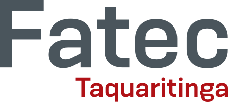
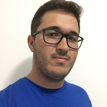
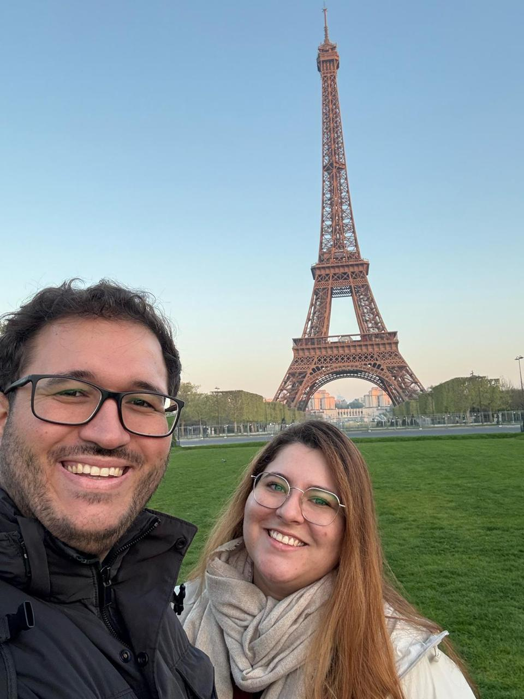
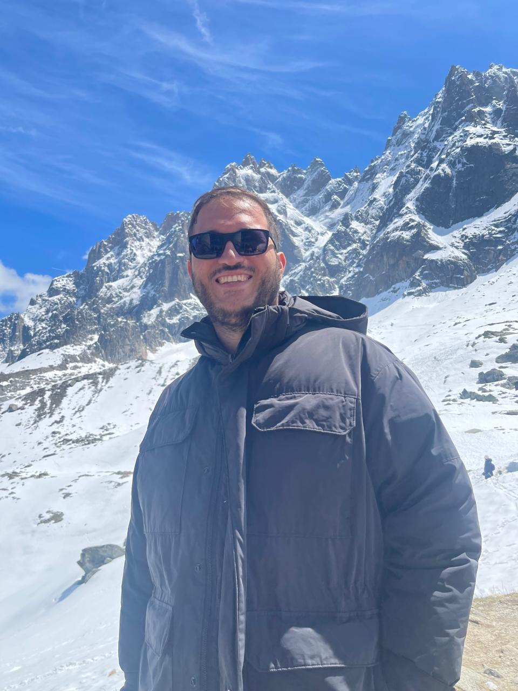
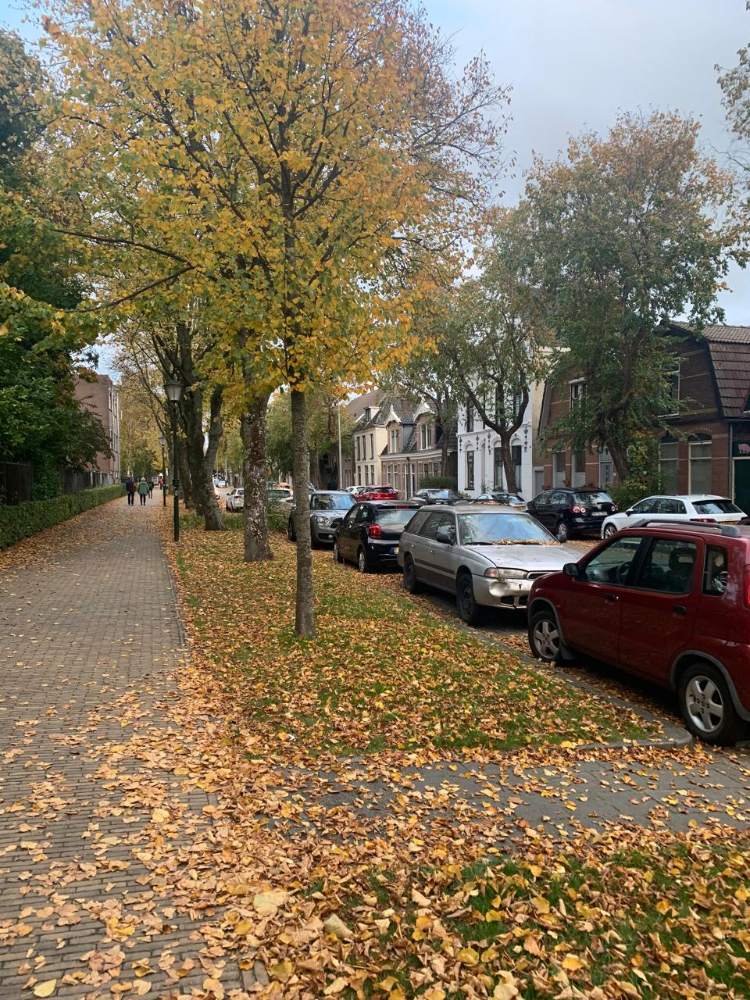

<!-- _backgroundImage: url('./img/hero-background.svg') -->

# **De onde vim**
## Uma trajetória real no mercado de TI

 
 

Itor Isaias - Professor & Software Engineer

---

# **Whoami**
## Itor Isaias

- <i class="fa-brands fa-linkedin"></i> [itorisaias](https://www.linkedin.com/in/itorisaias/)
- <i class="fa-brands fa-github"></i> [itorisaias](https://github.com/itorisaias)
- Software Engineer - atualmente na Holanda
- Professor na FATEC em 2024

---

---

---

---

---

# **De onde vim**

- Entrei na FATEC em **2013** curso de ADS
- Não era o melhor aluno, mas era **muito esforçado**
- No começo: foco em **passar nas matérias**, não no mercado
- No 4º semestre: **choque de realidade** em Engenharia de Software
- Professores me ajudaram a enxergar a diferença entre faculdade e mercado

> _"A faculdade te dá a base. O mercado te dá a direção."_

---

# **As conexões que mudaram tudo**

- Recebi a **primeira oportunidade** pelo professor Carlão
- Comecei em uma empresa pequena em **Focus**
- Depois: Ribeirão Preto -> Araraquara -> Campinas -> São Paulo
- Cada cidade, cada empresa: **novas conexões**
- Trabalhando remotamente, resolvi problemas com pessoas do mundo todo
- Uma dessas conexões me convidou para uma **empresa internacional**

> _"Networking não é sobre quantidade. É sobre profundidade."_

---

# **O que fiz para me manter e crescer**

Nunca parei de estudar, mesmo fora do trabalho:

| Canal | Como usei |
|---|---|
| YouTube / Udemy | Cursos práticos |
| Stack Overflow | Resolver problemas reais |
| Eventos | Networking + tendências |

- Explorei **frontend, backend, infra, testes e dados**
- Investia **grande parte do salário** em cursos e eventos
- Não esperava a empresa pagar - eu pagava

---

# **O desafio do mercado internacional**

- Entrei mesmo com **insegurança no inglês**
- No começo: medo, travava, não entendia tudo
- O que me manteve: **entregar valor além da comunicação**

 

Com o tempo:

- Confiança cresceu na prática
- Hoje: **lidero projetos** e participo de decisões importantes
- O idioma veio como consequência do comprometimento

---

# **Onde estou hoje**

- Software Engineer - morando e trabalhando na **Holanda**
- Lidero projetos com times internacionais
- Em **2024** voltei à FATEC como professor - e foi transformador
- Ensinar reforçou minha base: lógica, algoritmos, fundamentos
- Em 2025 me afastei da docência para me dedicar à mudança

 

Ensinar me fez um engenheiro melhor.

---

# **O que aprendi (e o que quero que vocês levem)**

- **Esforço** supera talento sem dedicação
- **Networking** muda carreiras - cuide das suas relações
- **Base forte** é essencial - não pule etapas
- **IA multiplica** quem já tem conhecimento
- **Aprendizado contínuo** é o único diferencial real

 

> _Você está no lugar certo. O que você vai fazer com isso?_

---

# **O mercado hoje**

- **IA** está remodelando todas as funções de TI
- Quem **domina fundamentos** usa IA com muito mais poder
- Mercado internacional **cada vez mais acessível** para brasileiros
- Inglês deixou de ser diferencial - virou **requisito**
- Soft skills (comunicação, autonomia) pesam tanto quanto hard skills

 

A janela de oportunidade está aberta. Por quanto tempo?

---

<!-- _backgroundImage: url('./img/hero-background.svg') -->

# **Obrigado**

 

Perguntas?

- <i class="fa-brands fa-linkedin"></i> [linkedin.com/in/itorisaias](https://www.linkedin.com/in/itorisaias/)
- <i class="fa-brands fa-github"></i> [github.com/itorisaias](https://github.com/itorisaias)
